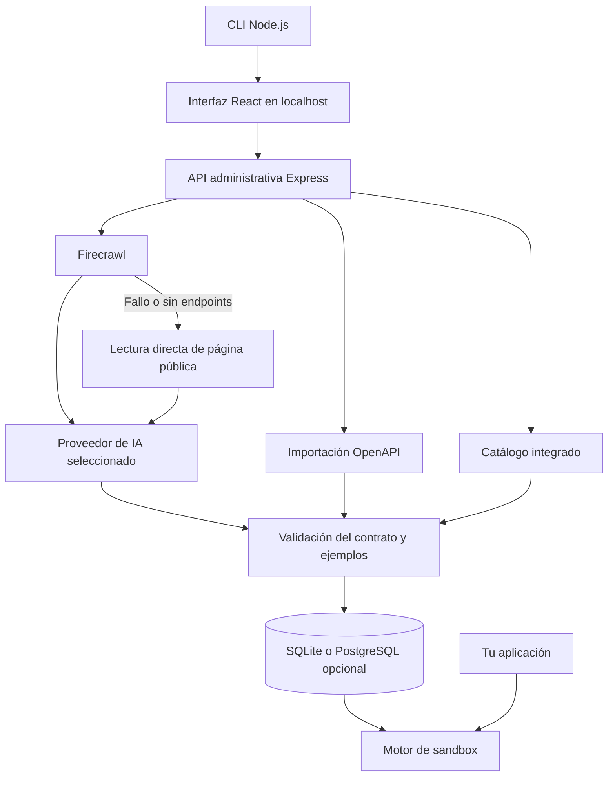

<div align="center">

# DocApiLab

### De documentación a localhost.

**Construye tu integración antes de recibir las credenciales del proveedor.**

Convierte documentación de APIs en sandboxes locales para desarrollar y probar desde tu aplicación.

**by [SeedCrafterLabs](https://github.com/SeedcrafterLabs)**


[Inicio rápido](#inicio-rapido) · [Funciones](#funciones) · [Configuración](#configuracion) · [Arquitectura](#arquitectura) · [Contribuir](#contribuir)

</div>

---

## 💡 ¿Qué es DocApiLab?

Quieres integrar una API, pero todavía no tienes acceso a su entorno de pruebas. DocApiLab te permite avanzar: proporcionas documentación pública, genera un contrato validado y publica endpoints simulados en tu máquina.

Tu aplicación consume esos endpoints mientras desarrollas. Cuando recibas las credenciales reales, puedes generar una propuesta de migración para revisar los cambios de URL y autenticación.

```text
Documentación → Firecrawl → IA → Contrato OpenAPI validado
                                          │
                                          ▼
Tu aplicación ────────────────────→ Sandbox local
                                    localhost:4000
```

> Los datos son simulados. DocApiLab no sustituye la validación contra la API real ni garantiza equivalencia con producción.

## 🎯 ¿Para quién es?

| Equipo | Cómo ayuda |
| --- | --- |
| Desarrolladores de integraciones | Trabajar con rutas y respuestas antes de obtener credenciales. |
| Equipos de hackathon | Preparar demos con endpoints locales y escenarios controlados. |
| Frontend y QA | Probar éxito, errores y latencia sin depender del proveedor. |
| Equipos de prototipado | Importar un contrato OpenAPI y preparar la integración. |

<a id="funciones"></a>

## ✨ Funciones

| Función | Disponible en el MVP |
| --- | --- |
| Documentación por URL | Lectura con Firecrawl y extracción con el proveedor de IA seleccionado. |
| Lectura de respaldo | Si Firecrawl falla o no encuentra endpoints, intenta leer la página directamente. |
| Recorrido de documentación | Hasta 30 páginas y 6 análisis de IA; enlaces del mismo sitio y profundidad máxima de 2. |
| Importación OpenAPI | JSON/YAML, sin claves de IA ni Firecrawl. |
| Catálogo integrado | INEGI, Frankfurter, JSONPlaceholder y PokéAPI. |
| Sandbox | Métodos y rutas del contrato, con validación de parámetros y cuerpos JSON. |
| Autenticación simulada | Gestionada automáticamente; los ejemplos locales no requieren inventar tokens. |
| Escenarios | Éxito, error y latencia configurable. |
| Gestión | Crear, iniciar, pausar y eliminar sandboxes. |
| Probador web | Método, URL, headers, cuerpo, respuesta y ejemplo de consumo. |
| Exportación | Contrato OpenAPI descargable por integración. |
| Migración | Parche revisable para JavaScript/TypeScript, variables de entorno e instrucciones. |
| Almacenamiento | SQLite automático; PostgreSQL opcional. |

Las consultas a los sandboxes **no llaman a la IA, a Firecrawl ni a la API del proveedor**.

<a id="inicio-rapido"></a>

## 🚀 Inicio rápido

### Ejecutar desde el repositorio

Requiere **Node.js 24 o posterior**, npm y acceso al repositorio:

```powershell
git clone https://github.com/SeedcrafterLabs/DocAPILab.git
cd DocAPILab
npm ci
npm run build
npm start
```

Abre automáticamente **http://127.0.0.1:4000**. Si el puerto está ocupado, intenta los siguientes disponibles e imprime la dirección elegida. Mantén la terminal abierta; **Ctrl+C** detiene el servidor.

> Si el repositorio es privado, necesitas acceso de GitHub para clonarlo.

### Primer sandbox sin claves

1. Abre **Catálogo de APIs**.
2. Selecciona una API y pulsa **Crear sandbox**.
3. Envía una solicitud desde el probador.
4. Copia el ejemplo de consumo a tu aplicación.

También puedes elegir **Agrega tu documentación** e importar OpenAPI JSON/YAML sin configurar servicios externos.

### Generar desde una URL

1. En **Ajustes**, selecciona OpenAI, DeepSeek, Google Gemini o Anthropic.
2. Guarda tu clave personal del proveedor y tu clave de Firecrawl.
3. Pega una URL pública, preferiblemente una referencia de endpoints.
4. Revisa el progreso en **Mis sandboxes** y prueba las operaciones generadas.

### Distribución con npx

Paquete preparado: **`@seedcrafterlabs/docapilab`**, comando **`docapilab`**. La publicación en npm está pendiente; este comando será la entrada cuando esté publicado:

```sh
npx @seedcrafterlabs/docapilab
```

Para probar o compartir el paquete local antes de publicar:

```powershell
npm pack
npm exec --package=./seedcrafterlabs-docapilab-0.1.0.tgz -- docapilab
```

El paquete local también requiere Node.js y acceso a npm para resolver dependencias. El ejecutable portable de Windows está pendiente de implementar.

<a id="configuracion"></a>

## ⚙️ Configuración

### Servicios externos

Para generar desde una URL necesitas **un proveedor de IA**, más **Firecrawl**:

| Servicio | Uso | Variable de clave |
| --- | --- | --- |
| OpenAI | Extraer el contrato de la documentación. | `OPENAI_API_KEY` |
| DeepSeek | Alternativa para extraer el contrato. | `DEEPSEEK_API_KEY` |
| Google Gemini | Alternativa para extraer el contrato. | `GEMINI_API_KEY` |
| Anthropic | Alternativa para extraer el contrato. | `ANTHROPIC_API_KEY` |
| Firecrawl | Obtener texto y enlaces de las páginas. | `FIRECRAWL_API_KEY` |

Guarda las claves desde **Ajustes**. Cada proveedor conserva su propia clave y modelo; guarda la selección para activarla. Firecrawl tiene un campo separado porque realiza la lectura de páginas.

El modelo es configurable y debe estar disponible para tu cuenta y ser compatible con la extracción. El consumo de servicios externos corresponde a las cuentas cuyas claves configures.

### Variables de entorno

Para desarrollo o despliegue:

```powershell
Copy-Item .env.example .env
```

Completa los valores que necesites. `npm start` carga `.env`; las variables del entorno tienen prioridad sobre las claves guardadas en Ajustes.

| Variable | Propósito |
| --- | --- |
| `DOCS2API_PROVIDER` | `openai`, `deepseek`, `google` o `anthropic`. |
| `OPENAI_MODEL`, `DEEPSEEK_MODEL`, `GEMINI_MODEL`, `ANTHROPIC_MODEL` | Modelo del proveedor correspondiente. |
| `HOST` / `PORT` | Dirección y puerto inicial; por defecto `127.0.0.1:4000`. |
| `DOCS2API_DATA_DIR` | Carpeta para ajustes y SQLite. |
| `DATABASE_URL` | PostgreSQL opcional; sin definir, se utiliza SQLite. |
| `AI_MAX_CALLS_PER_SESSION` | Cuota de llamadas por sesión/red durante la ejecución. |
| `AI_MAX_CALLS_TOTAL` | Cuota total de llamadas durante la ejecución. |
| `AI_MAX_OUTPUT_TOKENS` | Límite de salida de cada análisis. |

Las cuotas pueden detener una generación antes de los 6 análisis. Se conservan los nombres históricos `DOCS2API_*` por compatibilidad.

## 📚 Catálogo integrado

| API | Caso de uso | Operaciones |
| --- | --- | --- |
| INEGI | Indicadores y estadísticas de México. | Consulta de un indicador. |
| Frankfurter | Tipos de cambio y monedas. | 2 operaciones. |
| JSONPlaceholder | Prototipos de publicaciones REST. | 3 operaciones, incluyendo GET y POST. |
| PokéAPI | Listado y consulta de Pokémon. | 2 operaciones. |

Las entradas contienen contratos y ejemplos locales. Crear un sandbox del catálogo no contacta al proveedor ni descarga automáticamente toda su documentación.

## 🔄 Del sandbox a la API real

En **Migración**, selecciona un sandbox y carga un archivo JavaScript/TypeScript de tu integración. DocApiLab propone cambios sobre las URLs locales y la autenticación documentada.

Descarga el parche, el ejemplo de variables de entorno y las instrucciones. El procesamiento es local y determinista: los archivos no se envían al modelo ni se modifican silenciosamente. Revisa los cambios y valida contra la API real.

<a id="arquitectura"></a>

## 🏗️ Arquitectura



El motor interpreta contratos OpenAPI; **no ejecuta código generado por el modelo**. Cada sandbox conserva su contrato y versión. Las rutas se publican bajo un prefijo propio para aislar integraciones.

## 🔐 Datos y privacidad

- **Sin base central obligatoria:** SQLite se crea automáticamente en tu equipo.
- **Persistencia local:** la carpeta predeterminada es `~/.docs2api`, dentro del perfil del usuario en Windows.
- **Claves personales:** se guardan sin cifrado en `settings.json`. La API de ajustes devuelve indicadores de configuración, no los valores de las claves.
- **Servicios externos:** la documentación se envía a Firecrawl y al proveedor de IA seleccionado. El respaldo consulta páginas públicas directamente.
- **Archivos compartidos:** no incluyas `.env`, `settings.json`, bases locales, `node_modules` ni credenciales en commits o paquetes.

Distribuir un paquete o compilado no obliga a hacer público el repositorio, pero tampoco impide inspeccionar su contenido. La distribución portable aún no está implementada.

## 📏 Límites del MVP

| Área | Alcance actual |
| --- | --- |
| Protocolos | APIs REST con respuestas JSON. |
| Indexación | Hasta 30 páginas, profundidad 2 y 6 análisis; puede terminar antes por cobertura o cuotas. |
| Extracción con IA | Hasta 3 operaciones principales por análisis; no garantiza cubrir toda la API. |
| Importación OpenAPI | Entre 1 y 80 operaciones. |
| Escrituras | POST, PUT, PATCH y DELETE simulados, sin persistencia de recursos de negocio. |
| Lectura directa | No es un navegador autónomo; no garantiza acceso a contenido con login o JavaScript. |
| Reinicios | Persisten sandboxes y escenarios; el progreso y las cuotas de generación viven en memoria. |
| Producción | La compatibilidad debe comprobarse con la API y las credenciales reales. |

## 🧰 Desarrollo

```powershell
# Pruebas sin claves reales
npm test

# Validación de TypeScript
npm run typecheck

# Compilar frontend y CLI
npm run build

# Servidor y frontend en desarrollo, en dos terminales
npm run dev:server
npm run dev
```

Para iniciar sin abrir automáticamente el navegador:

```powershell
npm start -- --no-open
```

### Estructura del proyecto

```text
src/
  server/       API administrativa, lectores, extracción, catálogo y sandbox
  shared/       Tipos y definición de proveedores
  web/          Interfaz React
tests/         Pruebas del motor y de los adaptadores
scripts/       Utilidades y verificación de interfaz
.env.example    Configuración de ejemplo sin secretos
Dockerfile      Imagen para despliegues opcionales
compose.yaml    Aplicación y PostgreSQL para despliegues opcionales
```

Docker y PostgreSQL son alternativas para alojar la aplicación; no son requisitos del flujo local.

<a id="contribuir"></a>

## 🤝 Contribuir

Consulta [CONTRIBUTING.md](CONTRIBUTING.md) para preparar el entorno y proponer cambios. Para agregar una API al catálogo, incluye un contrato OpenAPI, la fuente de documentación y ejemplos sin credenciales.

Al reportar un fallo de generación, comparte la URL pública y el mensaje de error sin claves ni datos privados. Los cambios al motor deben comprobar validación, escenarios y aislamiento entre integraciones.

## 📄 Licencia

Distribuido bajo [licencia MIT](LICENSE).

---

<div align="center">

**DocApiLab by SeedCrafterLabs**

Construye, prueba e integra desde tu máquina.

</div>
